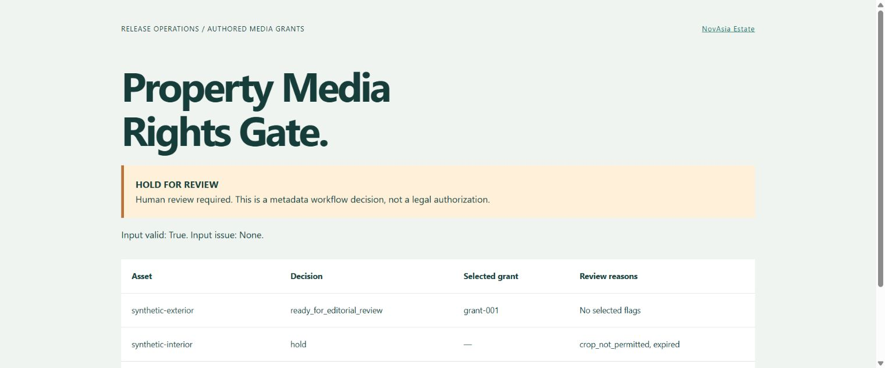

# Property Media Rights Gate

**An offline Open Policy Agent policy pack for a property media release desk.** Check whether the explicitly authored grant records for a photo, map or illustration cover a proposed channel, market, date, crop and attribution state.

Developed by [NovAsia Estate](https://novasia.estate/). MIT licensed.



This is a workflow gate over supplied metadata. It does not read contracts, identify copyright owners, infer licenses, verify evidence or grant legal permission. Every output keeps `human_review_required: true`.

## Why a separate tool?

An image can open correctly and pass duplicate/GPS checks while still lacking a usable publication grant. A designer can have permission for a website image without permission to crop it or reuse it in a printed brochure. This pack keeps those decisions explicit and reproducible in editorial CI.

## Evaluate a release

Requires OPA 1.x. Compatibility is checked on 1.0.1 and 1.22.2.

```sh
opa check --strict policies
opa test policies tests -v
opa eval --format raw --data policies --input examples/release.json data.novasia.media_rights.decision > decision.json
python tools/render_report.py decision.json review.html
```

Python 3.11+ is needed only for the optional report renderer; policies have no runtime dependencies or network calls. Read the raw JSON directly or open the portable local HTML report. Input examples are wholly synthetic and do not represent actual grants or NovAsia media inventory.

The bundled example has three assets: one is ready for editorial review, one is held because its grant expired and does not allow cropping, and one has no authored grant. The release stays on hold.

## Input and result

The input selects an explicit `as_of` day, a channel (`web`, `portal`, `print`, `social`) and an exact market label. Each requested asset declares whether it was cropped and whether the required attribution was supplied. Each grant has an opaque evidence reference and reviewer reference, confirmation/revocation flags, an inclusive date window, allowed channels/markets and crop/attribution requirements.

Multiple grants are alternatives: one complete applicable grant suffices. Permissions from two incomplete grants are **never combined**. The lexically first applicable grant ID is selected for a deterministic audit. Revocation applies to that grant only; an asset-wide or owner-wide revocation must be reflected in all affected records by the evidence owner.

`selected_checks_pass` is true only when input is valid and every requested asset has an applicable grant. Invalid metadata anywhere, including an unrelated grant, fails the entire request closed with one fixed input issue and no asset decisions. It is not a legal clearance or automatic publication command.

To use as a CI gate, explicitly assert the selected value:

```sh
opa eval --fail --format raw --data policies --input release.json 'data.novasia.media_rights.decision.selected_checks_pass == true'
```

Plain `opa eval decision` returning exit 0 means evaluation succeeded; it does not mean a release passed. Keep human approval as a separate release step.

## Included

- Two Rego modules: strict metadata validation and deterministic release decisions.
- 38 behavioral policy tests: boundaries, leap dates, scopes, duplicates, revocation, alternatives and minimal outputs.
- Synthetic three-asset input and expected decision.
- Escaped offline HTML renderer and example report.
- Artifact Hub metadata, installation instructions, CI and the MIT license.

Limits: 500 selected assets, 1,000 grants, 20 labels per scope, 64-character ASCII IDs, 500-character attribution text, dates from 1900 through 2100. There is no wildcard, fuzzy match, currency model, clock lookup, content download or account access. The application loading JSON must enforce its own byte and resource limits.

Read [input contract](https://github.com/novasia-estate/property-media-rights-gate/blob/main/docs/input.md), [decision semantics](https://github.com/novasia-estate/property-media-rights-gate/blob/main/docs/decisions.md), [CI integration](https://github.com/novasia-estate/property-media-rights-gate/blob/main/docs/integration.md) and [security/limitations](https://github.com/novasia-estate/property-media-rights-gate/blob/main/docs/limits.md).
